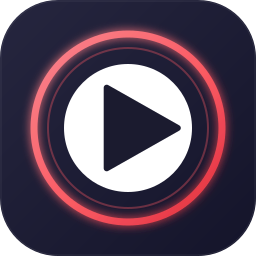
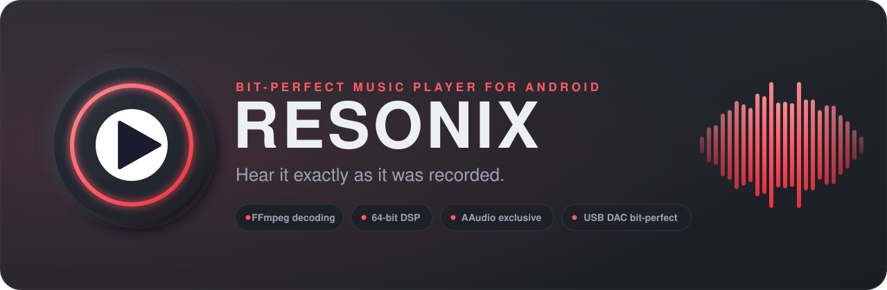
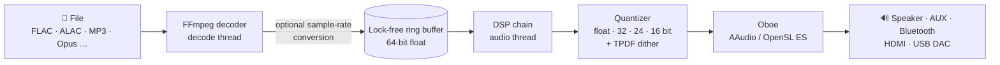
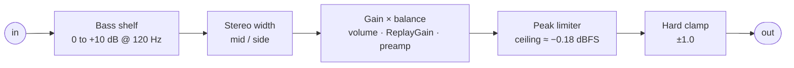
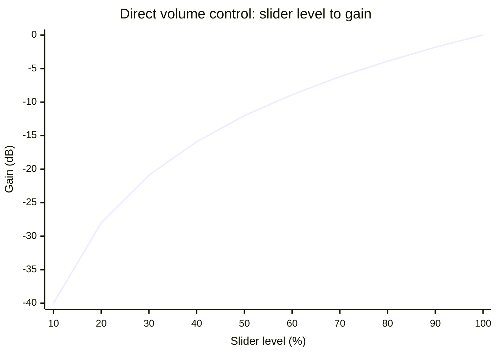
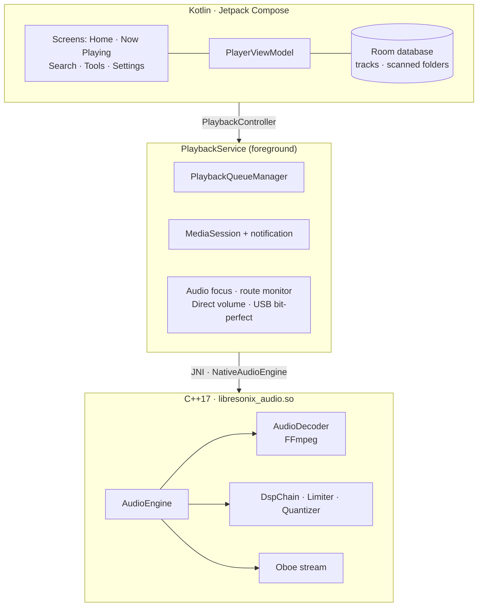
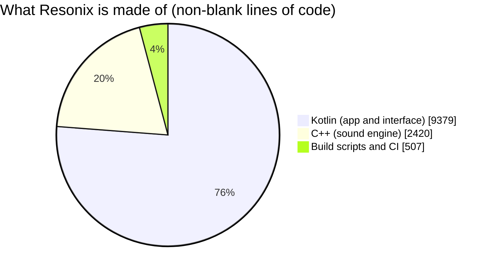

<div align="center">

<br/>



# Resonix

### Bit-Perfect Music Player for Android

<p>
  <strong>Your music, exactly as it was recorded.</strong><br/>
  <em>A native C++ audio engine with FFmpeg decoding, 64-bit processing, exclusive-mode output and USB DAC bit-perfect playback, wrapped in a soft neumorphic interface.</em>
</p>

<br/>

<p align="center">
  
  
  <a href="https://github.com/aravindrejidev/Resonix/stargazers"></a>
  <a href="https://github.com/aravindrejidev/Resonix/blob/main/LICENSE"></a>
  <a href="https://github.com/aravindrejidev/Resonix/commits"></a>
</p>

<p align="center">
  
  
  
  
  
  
</p>
<br/>

[**Features**](#features) · [**Signal Path**](#signal-path) · [**Download**](#download) · [**Settings**](#settings) · [**Build**](#build) · [**Architecture**](#architecture) · [**Roadmap**](#roadmap) · [**Contributing**](#contributing) · [**Disclaimer**](#disclaimer)

<br/>

</div>

> [!NOTE]
> Resonix is in **beta (v0.1.0)**. The playback engine, output planning and sound-shaping tools are working. The **10-band equalizer is interface-only for now**: its bands are saved and drawn, but the engine does not apply them yet (see the [Roadmap](#roadmap)). What "bit-perfect" can mean depends on your phone and where the sound goes; see the [Disclaimer](#disclaimer).

---

<a id="about"></a>
## 🌟 About the Project

**Resonix** is a native Android music player for people who care about what happens between the file and the speaker. It does not hand your music to the system player. It decodes every file with FFmpeg, keeps the signal in 64-bit floating point, does the final rounding to 16 / 24 / 32 bit itself (with proper dither), and sends the result to the hardware through Oboe, using AAudio in exclusive mode where the device allows it. Plug in a USB DAC on Android 14 or newer and Resonix asks the system for a strict bit-perfect path.

When you change nothing (no gain, bass, width or balance), the sound chain is an exact pass-through: a 16-bit file played to a 16-bit stream comes out bit-for-bit identical. The developer's host-side engine tests check this (see [`CHANGES.md`](CHANGES.md)).

No accounts. No ads. No telemetry. The app does not even ask for the Internet permission. Your music is read from the folders you choose and stays on your phone.

<div align="center">
  
</div>

<!--
  SCREENSHOTS: add your images to docs/screenshots/ and remove this comment markup
  to show the gallery. Suggested shots: Home, Now Playing (full-frame), Now Playing
  (framed), Tools, Settings > Audio engine, Search.

<br/>

<div align="center">
  <table>
    <tr>
      <td width="33%" align="center"><br /><sub><b>Home</b></sub></td>
      <td width="33%" align="center"><br /><sub><b>Now Playing</b></sub></td>
      <td width="33%" align="center"><br /><sub><b>Tools</b></sub></td>
    </tr>
    <tr>
      <td width="33%" align="center"><br /><sub><b>Audio engine</b></sub></td>
      <td width="33%" align="center"><br /><sub><b>Search</b></sub></td>
      <td width="33%" align="center"><br /><sub><b>Themes &amp; accents</b></sub></td>
    </tr>
  </table>
</div>
-->

---

<a id="features"></a>
## ✨ Features

<div align="center">

<table>
  <tr>
    <td width="50%" valign="top">

#### Audio Engine
- **FFmpeg decoding** — a native FFmpeg build (LGPL, `n9.0.1`) reads FLAC, ALAC, WAV, AIFF, APE, WavPack, TTA, MP3, AAC, Opus, Vorbis, WMA, AC3, DTS and more, including 24-bit files.
- **64-bit signal path** — decoder output, ring buffer and DSP all run in double precision. The signal is rounded once, at the very end.
- **Neutral means untouched** — with every control at its neutral value the chain is an exact pass-through, and the limiter stays out of the way.
- **Lock-free by design** — a single-producer / single-consumer ring buffer and atomic parameters. No locks and no allocations on the audio thread.
- **Sample-accurate seeking** — the decoder drops audio up to the exact target. The position you see is the audio you *hear*, not what the decoder has read ahead.
- **Adaptive buffer** — grows by one burst each time the device underruns.
- **Safe fallbacks** — AAudio ⇄ OpenSL ES, DAC refused → default device, 24-bit refused → float, and an `AudioTrack` driver if native output cannot open at all.

#### Output & Devices
- **Output API** — Auto, AAudio or OpenSL ES. If one cannot open, the other is used.
- **Exclusive mode** — asks for sole access to the stream and skips Android's mixer and its effects.
- **Bit-perfect sample rates** — each song plays at its own rate, or the nearest rate the output accepts. Switch it off and everything goes out at the device's own rate, so the stream never reopens between songs.
- **USB DAC bit-perfect (Android 14+)** — picks the best format the DAC offers and asks the system for a strict stream: no conversion, no resampling, no effects.
- **Output awareness** — knows whether sound goes to a USB DAC, AUX, Bluetooth, HDMI or the speaker. Plugging a DAC in or out re-plans the song and carries on from the same position.
- **Output format** — Auto (32-bit float), Float, 32, 24 or 16 bit. The engine does the final rounding itself.
- **TPDF dither** — Off, Auto or Always. *Auto* adds it only when the signal was changed or has to be rounded down.
- **Resampler quality** — Standard, High or Maximum.

    </td>
    <td width="50%" valign="top">

#### Volume & Sound Shaping
- **Direct Volume Control** — the engine sets the loudness in 64-bit precision with dither. It folds Android's current volume into its own level (so switching it on never changes the loudness), can park the system volume at maximum while music plays, and puts it back at equal loudness afterwards, even after a crash. The hardware volume keys control the engine level.
- **ReplayGain** — Off, Track or Album. Opus R128 tags are understood too.
- **Peak limiter** — ceiling at about −0.18 dBFS, 5 ms attack, 100 ms release, one shared gain for all channels so the stereo image never shifts. No lookahead, so no added latency.
- **Preamp** ±12 dB · **Bass boost** (low shelf, up to +10 dB below about 120 Hz) · **Stereo width** (mono to twice as wide) · **Balance** (left ↔ right).
- **Click-free** — gain and balance changes glide in over about 10 ms.
- **Sleep timer** — 15, 30, 45, 60 or 90 minutes. It lives in the playback service, so it keeps running when the app is closed.
- **Equalizer (interface preview)** — 10 bands from 31 Hz to 16 kHz, ±12 dB, with 9 presets. Engine support is in progress.

#### Playback
- **Folder-based queue** with Play, Shuffle, Next / Previous and automatic advance. Unreadable files are skipped.
- **Media session & notification** — Previous, Play / Pause and Next on the lock screen, in the notification and on headset or Bluetooth buttons.
- **Audio focus** with ducking, and an automatic pause when headphones are unplugged.
- **Background playback** — a foreground media service with a wake lock keeps music going with the screen off.

#### Library
- **Folder scanner** — pick your music folders with Android's system picker (no broad storage permission needed). Sub-folders are included, hidden folders are skipped.
- **Device library scan** — optionally also find songs indexed by Android's MediaStore.
- **Metadata** — tags are read natively through FFmpeg, with Android's own retriever filling any gaps. Embedded cover art is loaded down-sampled and cached.
- **Quality badges** — format, bit depth and sample rate in the lists, plus a *Hi-Res Lossless* / *Lossless* label on Now Playing.
- **Browse & find** — folder by folder, sort by title, artist, date added or length (ascending or descending), search, and rescan a folder. Resonix remembers the last folder you opened.

#### Interface
- **Neumorphic design** — raised plates, pressed-in tracks, knobs and sliders, drawn with custom components.
- **Theme** — Light, Dark or follow the system, with five accent colours: Crimson, Kiwi, Ocean, Violet and Amber.
- **Now Playing** — full-frame artwork that fades into a background tinted from the cover's own colours, or a framed plate. Drag the cover down to close.
- **Mini player**, a floating navigation bar (Home · Tools · Settings), optional haptic ticks and edge-to-edge layout.

    </td>
  </tr>
</table>

</div>

---

<a id="signal-path"></a>
## 🎛️ How the Signal Path Works

Every sample takes the same route from the file to the hardware:



Inside the DSP chain, in this order:



| Stage | What it does |
|---|---|
| **Decoder** | FFmpeg turns any supported file into interleaved 64-bit PCM. If the output rate differs from the file's, libswresample converts it at the chosen quality. |
| **Ring buffer** | Holds about 2 seconds of 192 kHz stereo. The decode thread writes, the audio callback reads, and neither ever waits for the other. |
| **Bass shelf** | A low shelf built from the standard RBJ biquad formulas, at 120 Hz with up to +10 dB. Skipped when off. |
| **Stereo width** | Mid / side scaling for stereo audio: 0 is mono, 1 is the original image, 2 is twice as wide. |
| **Gain × balance** | Direct volume, ReplayGain and preamp multiplied into one smoothed gain (up to +12 dB), plus left / right balance for stereo. |
| **Peak limiter** | Only active when the chain *can* raise the level (gain above unity, bass boost, wider image). Default playback is never touched. |
| **Quantizer** | Rounds to the output format. 16 and 24 bit use TPDF dither of ±1 LSB, and *Auto* skips it when the signal is already on the output's grid. |

> [!TIP]
> The DSP chain handles up to 8 channels. Stereo width and balance apply to stereo audio; other layouts get the gain, bass and limiter stages.

### Picking the output sample rate

With **Bit-perfect output** on, the engine keeps the file's rate whenever the output accepts it. Otherwise it picks the nearest rate in the same family (44.1 → 88.2 / 176.4, 48 → 96 / 192), because whole-number ratios resample most cleanly, and as a last resort the closest rate above.

| File | Output accepts | Resonix plays at |
|---|---|---|
| 44.1 kHz | 44.1 kHz and others | **44.1 kHz** (unchanged) |
| 44.1 kHz | 48 / 88.2 / 176.4 kHz | **88.2 kHz** (same family) |
| 44.1 kHz | 48 / 96 / 192 kHz only | **48 kHz** (closest above) |
| 96 kHz | 44.1 / 48 kHz only | **48 kHz** (best the device offers) |

### Resampler quality

Used only when a sample-rate change is actually needed. Passband error at 20 kHz, as measured by the developer's own host-side tests (see [`CHANGES.md`](CHANGES.md)):

| Quality | 20 kHz passband error |
|---|---|
| Standard | 0.50 dB |
| **High** (default) | 0.006 dB |
| Maximum | 0.000 dB |

### Direct volume control curve

The engine's gain is the slider level squared, so the lower half of the slider has useful resolution:



---

<a id="download"></a>
## 📥 Download & Installation

<div align="center">

<a href="https://github.com/aravindrejidev/Resonix/releases/latest" target="_blank" rel="noopener noreferrer"></a>
<a href="https://apps.obtainium.imranr.dev/redirect?r=obtainium://add/https://github.com/aravindrejidev/Resonix" target="_blank" rel="noopener noreferrer"></a>

Grab the APK from the [Releases](https://github.com/aravindrejidev/Resonix/releases) page. Android 8.0 (API 26) or newer is required.

</div>

**Other ways to get a build**

- **GitHub Actions:** open **Actions → Manual Build → Run workflow**. When it finishes, download the `resonix-debug-apk` artifact.
- **From source:** see [Build from Source](#build).

### Supported devices

One APK contains the native engine for all of these:

| ABI | Devices |
|---|---|
| `arm64-v8a` | Almost every modern phone and tablet |
| `armeabi-v7a` | Older 32-bit ARM devices |
| `x86_64` | Emulators and Intel / AMD Android devices |

### Installing

1. Enable **Install unknown apps** for the app you use to open the APK (browser or file manager).
2. Open the downloaded APK and confirm the installation.
3. Or, from a computer with USB debugging on:
   ```bash
   adb install -r app-debug.apk
   ```

### Getting Started

1. Open Resonix and allow access to your audio when asked (and notifications on Android 13+, so playback controls can show).
2. On **Home**, tap **Add music folder** and pick the folder your music lives in. You can also choose **Scan device library** to include songs Android has indexed.
3. Tap a song, or use **Play** / **Shuffle** on a folder.
4. Open the mini player for **Now Playing**. Drag the cover down to close it, or use the ⋮ menu for full-frame artwork, keep-screen-on and sound tools.
5. Open **Tools** to shape the sound, and **Settings → Audio engine** to tune the output.

> [!TIP]
> **Listening through a USB DAC?** Use Android 14 or newer, keep **Settings → Audio engine → USB DAC bit-perfect** on, and check the *Connected output* card. While the bit-perfect path is engaged, volume comes from Direct volume control, which Resonix switches on for you.

### Permissions

Resonix asks only for what it needs, and **it has no Internet permission**.

| Permission | Why |
|---|---|
| `READ_MEDIA_AUDIO` (Android 13+) / `READ_EXTERNAL_STORAGE` (up to Android 12L) | Scan the device library. Folders you pick with the system picker need no storage permission. |
| `POST_NOTIFICATIONS` (Android 13+) | Show the playback notification and its controls. |
| `FOREGROUND_SERVICE` · `FOREGROUND_SERVICE_MEDIA_PLAYBACK` | Keep playing in the background. |
| `WAKE_LOCK` | Keep the CPU awake while music plays with the screen off. |
| `MODIFY_AUDIO_SETTINGS` | Bit-perfect USB mixer (Android 14+) and volume handling. |

<details>
<summary><b>Recognised audio file types</b></summary>

<br/>

The library scanner accepts anything Android reports as audio, plus these extensions that FFmpeg plays but the system often does not label as audio:

`mp3` `mp2` `flac` `wav` `wave` `aif` `aiff` `aifc` `m4a` `m4b` `aac` `ogg` `oga` `opus` `wma` `alac` `ape` `wv` `tta` `dsf` `dff` `mka` `mpc` `caf` `ac3` `dts` `amr`

Whether a particular file plays depends on the bundled FFmpeg build.

</details>

---

<a id="settings"></a>
## ⚙️ Settings & Tools

Settings are grouped into pages, and every row on the main list shows what is currently chosen. Changes reach the audio engine immediately.

<details>
<summary><b>Full settings reference</b></summary>

<br/>

| Page | Option | Default |
|---|---|---|
| **Appearance** | Theme: System / Light / Dark | System |
| | Accent colour: Crimson / Kiwi / Ocean / Violet / Amber | Crimson |
| | Haptic feedback | On |
| **Player** | Full-frame artwork | On |
| | Keep screen on while the player is open | On |
| | Notification controls (opens system settings if blocked) | n/a |
| **Library** | Music folders: add and rescan | n/a |
| | Scan device library | n/a |
| | Quality badges in song lists | On |
| | Album art in song lists | On |
| **Audio engine** | Connected output (read-only: USB DAC / AUX / Bluetooth / HDMI / Speaker) | n/a |
| | Output: Auto / AAudio / OpenSL ES | Auto |
| | Exclusive mode | On |
| | Bit-perfect output | On |
| | USB DAC bit-perfect (Android 14+) | On |
| | Bits per sample: Auto / Float / 32 / 24 / 16 | Auto |
| | Dither: Off / Auto / Always | Auto |
| | Resampler quality: Standard / High / Maximum | High |
| | Direct volume control | Off |
| | Park system volume at maximum (while DVC is on) | On |
| | Volume level (while DVC is on) | 100 % |
| | ReplayGain: Off / Track / Album | Off |
| | Peak limiter | On |
| **About** | Version, licence and what Resonix is built with | n/a |

**Tools** tab: Equalizer (preview) · Sound shaping (Preamp, Bass boost, Stereo width, Balance) · Sleep timer · Signal, which shows the real output stream, for example `AAudio · Exclusive · 96 kHz`.

</details>

---

<a id="build"></a>
## 🛠️ Build from Source

**You need**

- **JDK 17**
- **Gradle 9.5.0**
- **Android SDK** with platform 37
- **NDK 28.2.13676358** and **CMake 3.22.1**

```bash
git clone https://github.com/aravindrejidev/Resonix.git
cd Resonix

# Build a debug APK (the FFmpeg libraries are already in the repository)
gradle :app:assembleDebug
# Built APK will be located at: app/build/outputs/apk/debug/
```

> [!TIP]
> The repository contains `gradle-wrapper.properties` but not the wrapper script itself. Run `gradle wrapper --gradle-version 9.5.0` once if you want a `gradlew`, or just open the project in a recent Android Studio.

Release builds turn on R8 minification. The ProGuard rules keep every class with a native method, so the JNI bridge survives.

### FFmpeg libraries

Resonix links against prebuilt FFmpeg shared libraries (`libavcodec`, `libavformat`, `libavutil`, `libswresample`, `libswscale`) kept in `app/src/main/cpp/ffmpeg/` for `arm64-v8a`, `armeabi-v7a` and `x86_64`. The CMake step stops with a clear message if they are missing.

To rebuild them (for example to change the FFmpeg version):

1. Open **Actions → Build FFmpeg (one-time, manual) → Run workflow**.
2. Download the `resonix-ffmpeg-libs` artifact.
3. Commit its contents into `app/src/main/cpp/ffmpeg/`.

The workflow builds FFmpeg `n9.0.1` with the NDK for Android 8.0+, as an LGPL-only, decode-only library: no encoders, no muxers, no command-line programs, and network support switched off.

### GitHub Actions

| Workflow | Trigger | Result |
|---|---|---|
| **Manual Build** | Run manually | Builds the debug APK and uploads it as `resonix-debug-apk` |
| **Build FFmpeg (one-time, manual)** | Run manually | Cross-compiles FFmpeg for each ABI and uploads `resonix-ffmpeg-libs` |

---

<a id="architecture"></a>
## 🏗️ Architecture & Tech Stack

Resonix is a single-module Kotlin app with a C++17 audio engine, joined by a thin JNI bridge. There are no third-party DSP libraries: the filters, limiter, dither and volume maths are written in this repository.



| Folder | What it does |
|---|---|
| `app/src/main/cpp/` | The sound engine: `AudioEngine`, `AudioDecoder` (FFmpeg), `TrackProber`, and the header-only `Dsp.h`, `Limiter.h`, `Quantizer.h` and `RingBuffer.h`, plus the JNI bridge in `native-lib.cpp` |
| `app/src/main/cpp/ffmpeg/` | FFmpeg headers and prebuilt shared libraries for each ABI |
| `audio/` | Kotlin side of the engine: `NativeAudioEngine` (JNI wrapper), track probing, codec and quality naming |
| `playback/` | `PlaybackService`, queue manager, audio focus, output routing and planning, Direct volume control, USB bit-perfect, and the `AudioTrack` fallback driver |
| `data/` | Room database, the folder (SAF) and MediaStore scanners, and the metadata fallback |
| `ui/` | Compose screens, the `neo/` neumorphic design system, theme, settings store, cover-art loading and colour extraction |
| `util/` | Small app-wide helpers such as toast messages |
| `.github/workflows/` | The manual build and FFmpeg workflows |

### Engine rules

These keep the audio thread glitch-free, and any change to the engine should respect them:

- The **decoder** is touched only by the decode thread. Seeks from other threads are posted as a request and picked up there.
- The **Oboe callback** only reads the ring buffer and runs the DSP chain. It never allocates, locks or blocks, and fills any underrun with silence.
- **Parameters** are atomics, so the UI can change them at any moment.
- The ring buffer is **flushed from the producer side** with a compare-exchange on the read index, so stale audio can never be replayed after a seek.

### Tech stack

| Component | Version |
|---|---|
| Kotlin | 2.4.20 |
| Android Gradle Plugin | 9.3.1 |
| Jetpack Compose BOM / Material 3 | 2026.08.00 |
| Room (with KSP 2.3.10) | 2.8.5 |
| Oboe (via Prefab) | 1.11.0 |
| FFmpeg | n9.0.1 (LGPL build) |
| NDK / CMake | 28.2.13676358 / 3.22.1 |
| Java | 17 |
| Android | min SDK 26 · target and compile SDK 37 |

**Built with:** Kotlin · Jetpack Compose · C++17 · Oboe · FFmpeg · Room · JNI · GitHub Actions

---

<a id="roadmap"></a>
## 🗺️ Project Status & Roadmap

<p align="center">
  <a href="https://github.com/aravindrejidev/Resonix/commits"></a>
  <a href="https://github.com/aravindrejidev/Resonix/graphs/commit-activity"></a>
  <a href="https://github.com/aravindrejidev/Resonix"></a>
  <a href="https://github.com/aravindrejidev/Resonix"></a>
  <a href="https://github.com/aravindrejidev/Resonix/issues"></a>
</p>

<div align="center">



</div>

**Done**
- [x] Native engine: FFmpeg decoder → 64-bit ring buffer → DSP → Oboe output
- [x] AAudio / OpenSL ES output with exclusive mode and automatic fallbacks
- [x] Bit-perfect sample-rate planning and a resampler with three quality levels
- [x] Output format (float / 32 / 24 / 16 bit) with TPDF dither
- [x] Direct volume control with system-volume folding and parking
- [x] USB DAC bit-perfect path (Android 14+) with live device re-planning
- [x] ReplayGain (track, album and Opus R128), peak limiter, preamp, bass boost, stereo width and balance
- [x] Sample-accurate seeking and a media session with a proper notification
- [x] Sleep timer that survives closing the app
- [x] Full-frame Now Playing with cover-tinted background, themes and accent colours

**In progress**
- [ ] **Equalizer engine.** The interface and 9 presets exist; the bands still need to be applied in `DspChain::process`, in front of the limiter.

**Ideas**
- [ ] Proper database migrations before 1.0 (today a schema change resets the library)
- [ ] Queue view and playlists
- [ ] Gapless playback
- [ ] A release workflow that publishes signed APKs

Have an idea? Open an [issue](https://github.com/aravindrejidev/Resonix/issues) and tell us.

### 📈 Star History

<p align="center">
  <a href="https://star-history.com/#aravindrejidev/Resonix&Date">
    
  </a>
</p>

---

<a id="support"></a>
## ☕ Support the Project

Resonix is free and open source, with no ads or subscriptions. If it made your music sound better, you can support it by:

- ⭐ **Starring** the repository
- 📣 **Sharing** it with fellow audio lovers
- 🐛 **Reporting** bugs and odd behaviour on the [issues page](https://github.com/aravindrejidev/Resonix/issues)

<!-- Add your donation links here, for example Ko-fi or PayPal -->

---

<a id="contributing"></a>
## 💡 Contributing

Contributions are welcome, whether it's a bug fix, a new feature, or better wording.

- **Something not working?** Open an [issue](https://github.com/aravindrejidev/Resonix/issues) with your phone model, Android version, where the sound goes (speaker, AUX, Bluetooth, USB DAC), the file format and sample rate, and what you expected. **Settings → Audio engine** and the **Signal** card in Tools show most of this.
- **Bigger changes:** open an issue first so we can talk it through.
- **Pull requests** should build cleanly (`gradle :app:assembleDebug`), follow the official Kotlin code style, and keep to the [engine rules](#engine-rules): no locks, allocations or blocking calls on the audio thread.

### 👥 Contributors

<div align="center">
  <a href="https://github.com/aravindrejidev/Resonix/graphs/contributors">
    
  </a>
</div>

---

## 🎧 More from the Same Author

| Project | What it is |
|---|---|
| [**Resonix TV**](https://github.com/aravindrejidev/Resonix-TV) | Home-cinema audio player for Android TV, with a per-channel mixer, graphic and parametric EQ, and FFmpeg decoders for DTS, TrueHD and E-AC3 |
| [**Spectra**](https://github.com/aravindrejidev/Spectra) | Audio forensics analyzer for Android: spectrogram, fake-lossless detection, LUFS, true peak and dynamic range |

---

<a id="acknowledgments"></a>
## 🤝 Acknowledgments

- **[Oboe](https://github.com/google/oboe)** — Google's C++ library for low-latency audio on Android.
- **[FFmpeg](https://ffmpeg.org/)** — the decoders and resampler behind every file Resonix plays.
- **Robert Bristow-Johnson's *Audio EQ Cookbook*** — the biquad formulas behind the bass shelf.
- **[ReplayGain](https://wiki.hydrogenaudio.org/index.php?title=ReplayGain_specification)** — the loudness-normalisation tags Resonix understands.
- **Jetpack Compose** and **Room** — the foundations of the interface and the library database.

---

<a id="disclaimer"></a>
## ⚖️ License & Disclaimer

### License
Resonix is free software, released under the [GNU General Public License v3.0](LICENSE). It links FFmpeg, built as an LGPL-only version (no GPL parts), which is distributed under the LGPL. Oboe is distributed under the Apache License 2.0.

### Disclaimer
- **Beta software.** Resonix is at version 0.1.0. Expect rough edges, and please report them.
- **Bit-perfect has limits.** The engine can keep the signal untouched up to the point where it leaves the app. After that it depends on Android and your hardware. USB DAC bit-perfect needs Android 14 or newer and a DAC that offers a suitable format. Sound sent over Bluetooth or the built-in speaker is processed by the system or the radio link and cannot be bit-perfect.
- **The equalizer is not active yet.** Its controls are saved and drawn, but they do not change the sound until the engine part is finished.
- **Sound shaping is not magic.** Bass boost, width and gain change how a recording sounds. A large boost can still sound distorted, even though the limiter prevents clipping.
- **Measurements are the developer's own.** Figures such as the resampler's passband error come from the developer's host-side tests (see `CHANGES.md`), not from an independent lab.
- **Devices differ.** Android audio hardware and firmware vary a lot. If something misbehaves on your phone or DAC, please report it with the model name.
- **Privacy.** Everything happens on the device. Resonix has no Internet permission, no accounts and no telemetry, and it does not upload your music or your listening.

---

<div align="center">
  Built with care, one sample at a time. Happy listening! 🎧
</div>
